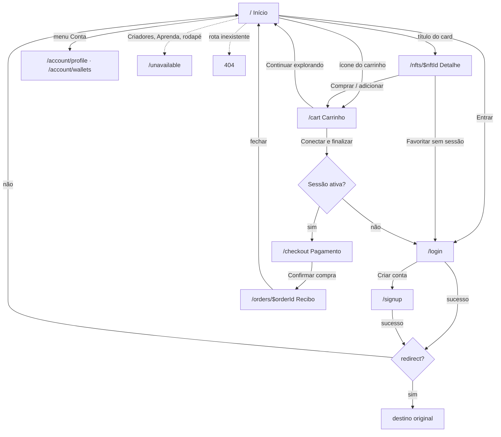
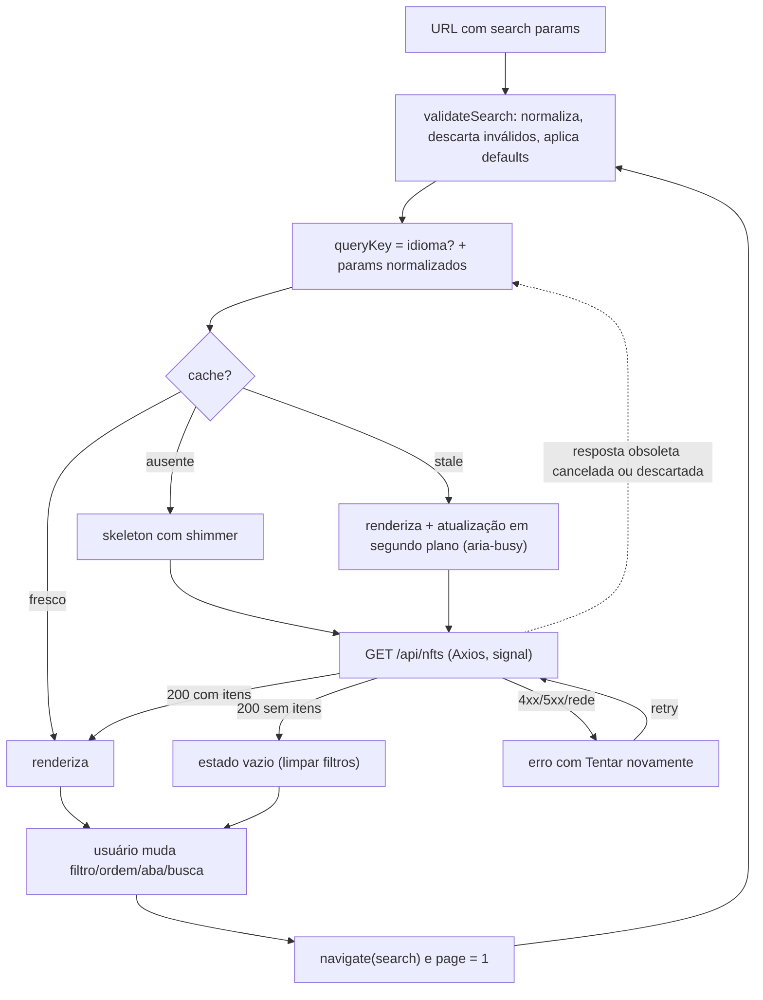
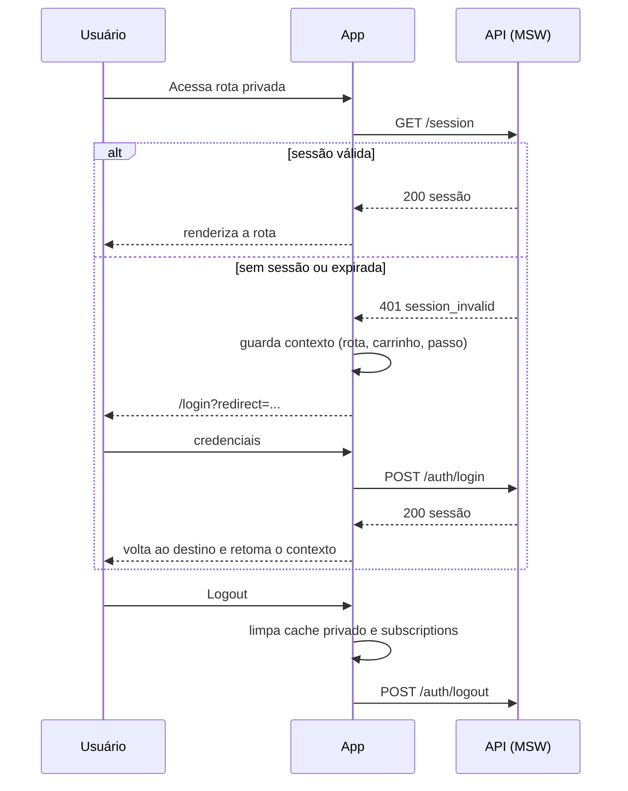
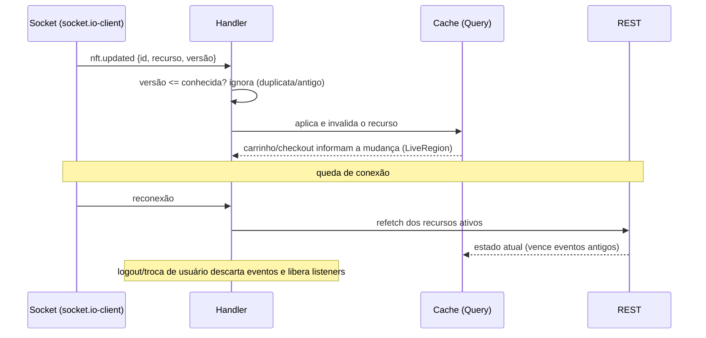
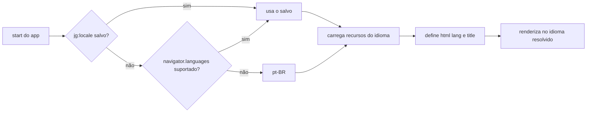

# Fluxogramas

Diagramas em Mermaid. Rotas e params: `docs/routes.md`. Contratos e eventos finais entram em `ARCHITECTURE.md` conforme cada feature.

## 1. Navegação geral

## 2. Home: da URL à tela

## 3. Sessão e expiração

## 4. Pedido: máquina de estados e idempotência

```mermaid
stateDiagram-v2
  [*] --> Revisao
  Revisao --> Revalidando: Confirmar compra
  Revalidando --> Revisao: cotação mudou (exige nova confirmação)
  Revalidando --> Enviando: cotação igual
  Enviando --> Pendente: pedido criado (chave de idempotência)
  Enviando --> Pendente: timeout (recupera o MESMO pedido pela chave)
  Pendente --> Confirmado: order.updated confirmado / REST
  Pendente --> Recusado: order.updated recusado / REST
  Confirmado --> [*]: recibo = snapshot; remove do carrinho só o comprado
  Recusado --> Revisao: itens preservados
```

Clique repetido reutiliza a mesma chave (não cria outro pedido); a mesma chave com conteúdo diferente devolve conflito. Estados `Confirmado` e `Recusado` são terminais.

## 5. Tempo real e reconciliação

## 6. i18n no bootstrap

